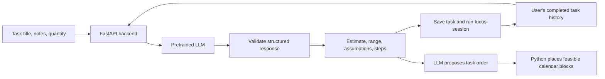

# Bringing generative planning to TimeBlindAI

Written against the repository and official documentation checked on 8 October 2026.

## What we are building

Use a pretrained language model to interpret a task, estimate its duration, explain assumptions, and produce useful steps. Use the model to propose an order for the day's tasks. Keep calendar arithmetic and constraint enforcement in Python.

For example, "Read 40 pages for an exam and take notes" contains meaning that a task-type multiplier misses. The model receives that description, the quantity, difficulty, deadline, and a small selection of this user's completed tasks. It returns an estimated duration, a plausible lower/upper range, assumptions, and steps. These numbers are planning suggestions; the range is not a calibrated probability interval.

The backend then checks that step times add up, validates the range, and determines whether the task actually fits before its deadline. A deadline does not make a task shorter. When a full task cannot fit, the app reports overflow or defers it.



You do not need to train an LLM to start. Calling a pretrained model through an API is **inference**. Putting relevant examples in its request is **few-shot prompting**. Changing its weights is **fine-tuning**, which is a later option once data and evaluation justify it. This implementation uses inference and few-shot examples, with no vector database or GPU requirement.

## What the repository already had

- FastAPI + SQLAlchemy backend and a Next.js frontend.
- Rule-based duration estimation, task decomposition, schedule placement, focus timers, and feedback.
- A regression training script and saved model artifact. The inspected runtime does not load that artifact.
- A CSV export joining task records and session feedback.

The regression files remain available as research references. The new runtime uses an LLM when explicitly enabled, and otherwise uses the existing rules.

## Model selection

The selected free-tier prototype option is **Groq hosting `openai/gpt-oss-120b`**. It supports strict JSON-schema outputs for estimates and task ordering. The `openai/` prefix identifies the model author; these requests go to Groq and use a **Groq key**, not OpenAI API credits. Live checks establish working integration, but the pilot below does **not** justify promoting this model as an accurate duration predictor. [Groq structured outputs](https://console.groq.com/docs/structured-outputs)

Groq's published free-plan limits for this model are 30 requests/minute, 1,000 requests/day, 8,000 tokens/minute, and 200,000 tokens/day. Your account's limits are authoritative; quotas can change. The evaluator spaces request starts by 60 seconds to reduce token-limit failures. No integration can guarantee unlimited free production usage. [Groq rate limits](https://console.groq.com/docs/rate-limits)

OpenAI remains an optional paid provider: select `LLM_PROVIDER=openai`, `LLM_MODEL=gpt-4.1-mini-2025-04-14`, and configure `OPENAI_API_KEY`. The initial OpenAI test was rejected because its credit balance was exhausted. Groq failures never cause an automatic OpenAI request. Existing rules remain available as the explicit fallback. [GPT-4.1 mini documentation](https://developers.openai.com/api/docs/models/gpt-4.1-mini)

The provider and model are configurable through `LLM_PROVIDER` and `LLM_MODEL`; no frontend changes are needed. GPT-OSS on Groq uses low reasoning effort and excludes reasoning text from the returned content. The client validates the JSON answer rather than reading reasoning fields. Compare failure rate and latency as well as accuracy.

Groq uses its Chat Completions endpoint with strict `response_format.json_schema`; OpenAI uses Responses with strict `text.format` and `store=false`. Unsupported parameters are not forwarded across providers. Strict formatting improves reliable parsing; it does not establish that estimates are correct. Backend validators also check step sums and ranges. No tools or arbitrary endpoints are enabled. [Groq API reference](https://console.groq.com/docs/api-reference)

## Dataset findings and what to use

The current CSV has **47 rows across 7 users**. There are **33 rows with a positive actual duration and an estimate**, but only **28 usable unique completed rows** under the new audit's rules. Two same-user/title/day entries are conservatively treated as duplicates; additional exclusions come from status and duration validation. Repeated tasks can be legitimate, so review these decisions before collecting a larger dataset.

This is a pilot dataset. It can expose obvious mistakes and test the pipeline, but cannot support a reliable broad accuracy claim. The old regression evaluation also includes `completed_session_count` as a feature, which is not available at task creation. Historical session counts can be useful; the target task's eventual session count leaks information from the outcome. Its reported error should not be used as a trustworthy prospective result.

| Dataset | Useful role | Limitation for TimeBlindAI | Decision |
| --- | --- | --- | --- |
| Your own task/session records | Personal duration estimates and evaluation | Small, noisy; elapsed time can include pauses | Primary data; keep collecting |
| [BLS American Time Use Survey](https://www.bls.gov/tus/data.htm) | Broad reference distributions for activities | Diary activity durations differ from completion time for a specific assignment; US population differs from your users | Optional later background analysis; do not merge directly into task labels |
| [Google DeepMind Natural Plan](https://github.com/google-deepmind/natural-plan) | Calendar/meeting/trip planning benchmark | Tests planning under supplied constraints, not personal task completion duration | Useful external scheduling evaluation source |
| [Microsoft TaskBench](https://github.com/microsoft/JARVIS/blob/main/taskbench/README.md) | Task decomposition and dependency-planning research | Tool-use plans, not measured human durations | Optional decomposition reference |

These are researched sources, not imported training data. No external dataset is silently mixed into your users' history. Inspect each dataset's actual license, terms, schema, and provenance before downloading or redistributing it. Public planning benchmarks do not supply the missing personal duration labels.

For the next collection round, capture task scope and units (pages, words, questions), familiarity, predicted minutes, actual focused minutes, wall-clock minutes, pause/interruption time, completion timestamp, prediction model/prompt version, and whether the prediction was AI or fallback. Distinguish a finished task from a partially finished session. Explicit completion timestamps will make chronological history-based evaluation possible.

Production history retrieval currently selects at most six examples from the most recent sixty completed tasks belonging to the requested user, preferring the same task type. It excludes other users' records and omits emails, IDs, and free-text feedback. The CSV is never loaded into live prompts. Existing API authentication is still needed to establish that a caller actually owns the supplied user ID.

## What has been implemented

- Server-only Groq Chat Completions and OpenAI Responses clients with bounded timeout/output tokens, no automatic retries, and no tools.
- Strict schemas for estimates, steps, and complete task ordering.
- LLM estimates and decomposition through the existing `/api/v1/tasks/decompose` endpoint.
- Task notes forwarded to decomposition from the existing frontend form.
- Generation source, approximate duration range, assumptions, explanation, and fallback notice in the frontend.
- LLM task ordering through `/api/v1/schedules/generate`, followed by deterministic placement.
- Scheduling checks for same-day windows, the user's IANA timezone, deadlines, dependencies, event preparation/commute reservations, buffers, and breaks between tasks when space permits.
- Draft replacement occurs only after successful generation; schedules with active or completed blocks must use recovery.
- Offline dataset audit and held-out comparison, with opt-in live evaluation against the selected provider.
- Automated tests with an isolated in-memory database and mocked provider responses.

For this first version, existing tasks keep their saved durations. Newly created tasks receive AI estimates when enabled. Schedule generation orders and places saved tasks; it does not re-estimate every task with additional calls. Event preparation arithmetic and schedule recovery remain deterministic. Single long tasks are not yet split into multiple calendar focus blocks. The scheduler seeks feasible slots; it is not an optimal scheduling solver.

Events without an end time conservatively reserve the remainder of that local day's planning window. Supply end times through the existing event API for a precise reservation. The current event form does not collect an end time. Breaks are inserted between tasks after sustained work where time permits; this does not enforce a break inside a long task. An LLM order exceeding sixty tasks falls back, or returns 503 in strict failure mode.

Estimate model/range metadata is returned to the client but is not yet persisted on the task. Schedule source is persisted through `generated_by`; its narrative is returned for the immediate request. Persist prediction records before making longitudinal research claims.

## Run locally

From the repository root:

```powershell
.venv/Scripts/python.exe -m pip install -e ".[dev]"
if (!(Test-Path .env)) { Copy-Item .env.example .env }
```

Edit the backend `.env` locally:

```dotenv
LLM_ENABLED=true
LLM_PROVIDER=groq
GROQ_API_KEY=your_private_groq_key
LLM_MODEL=openai/gpt-oss-120b
LLM_FAILURE_MODE=fallback
```

Create the key in [Groq Console](https://console.groq.com/keys) using its free plan. Keep it in the backend environment. Do not put it in a `NEXT_PUBLIC_` variable, source code, a screenshot, or chat. The repository ignores `.env`. Restart the backend after configuration changes because settings are cached. Existing OpenAI credentials may remain in `.env`; they are unused while Groq is selected. Connection checks initially used `LLM_FAILURE_MODE=error` to make failures visible. Local configuration now uses `fallback` for normal use; fallback plans are labeled in the UI.

```powershell
.venv/Scripts/python.exe -m uvicorn app.main:app --reload --port 8000
```

Run the frontend as before with `npm run dev` in `frontend`. Create a task with a concrete title, notes, difficulty, and quantity. Its latest prediction should say **AI estimate** and show the range and assumptions. Generate a schedule and check the result against a fixed event and a short deadline.

`LLM_ENABLED=false` disables model calls and uses rules. With AI enabled, `LLM_FAILURE_MODE=fallback` uses a clearly labeled rule-based plan on a missing key, timeout, refusal, rate limit, or invalid output. It does not change providers. Set `LLM_FAILURE_MODE=error` for evaluation or staging when you want a 503 instead of fallback. A normal `/health` response only confirms backend availability; it does not verify API credentials or model access.

## Evaluate before claiming better predictions

### First live connection check

The initial OpenAI request returned HTTP 429 with `credit_balance_exhausted`, so the project was switched to Groq at the user's request. Groq and GPT-OSS 120B are selected locally. The saved Groq key passed both live API-route checks in strict failure mode on 8 October 2026: duration estimation and schedule generation each returned HTTP 200 with `generation_source=llm`. OpenAI credits are not needed for the selected provider.

The synthetic reading task received a 35-minute estimate, a 30–45-minute planning range, and three steps totaling 35 minutes. The generated schedule placed reading before its dependent summary task and avoided the fixed calendar event. These checks establish working integration and constraint handling, not prediction accuracy. See `data/evaluation/groq_live_smoke_report.json` for the recorded result.

Run `python -m scripts.smoke_generative` after configuring the Groq key. It makes up to two live requests through the real API routes, using synthetic tasks and an isolated in-memory database, with one minute between Groq request starts. It checks estimate consistency, schedule dependency ordering, local timezone conversion, and avoidance of a fixed event. The report is saved to `data/evaluation/groq_live_smoke_report.json` for Groq (or `openai_live_smoke_report.json` for OpenAI). It does not read or change existing user tasks. A restricted execution environment needs network permission to reach the selected provider.

Provider diagnostics distinguish known billing and rate-limit codes without logging the key, response body, or task content. As of 12 October 2026, the automated suite passes 64 tests, including Groq request/schema handling, malformed and truncated answers, API-route compatibility, prevention of paid-provider fallback, separation of reference estimates from evaluation inputs, specific failure messages for schedule fallback, and deadline, dependency, buffer and fragmented-time explanations for unscheduled tasks.

```powershell
.venv/Scripts/python.exe -m pytest -q
.venv/Scripts/python.exe -m scripts.evaluate_generative
```

The default evaluation makes no API calls. It audits the CSV, excludes conservative duplicates, holds out the latest 20% of eligible records, and compares stored estimates with current rules. It supplies no starting estimate to either the rules or the LLM, matching the task form. Across six holdout examples, raw estimate MAE is **61.67 minutes**, and current rules without starting estimates have MAE **49 minutes**. This is a tiny sanity check, not a deployment-quality comparison or an LLM result.

The first live comparison, preserved in `data/evaluation/groq_live.json`, supplied stored estimates to both methods. All six Groq requests succeeded, with mean latency 2.13 seconds, but LLM MAE was 61.33 minutes versus 52.67 for seeded rules. None of its proposed ranges covered the actual durations. It reproduced the starting estimate in five of six cases. This seeded test does not represent the task form, which omits a starting estimate. Use `--estimate-input stored` to reproduce its input convention; the default is now `--estimate-input none`. No production prompt was tuned against these results.

After configuring a key and passing the smoke test, run the live comparison (it consumes provider quota):

```powershell
.venv/Scripts/python.exe -m scripts.evaluate_generative --live --limit 6 --out data/evaluation/groq_live_unseeded.json
```

It sends held-out task titles and metadata to the selected provider, omitting user IDs, feedback, and post-task features. Stored estimates remain reference results rather than model inputs by default. The report identifies the provider, model, and starting-estimate mode. It reports LLM MAE, median absolute error, approximate range coverage, failure rate, and mean latency. Failed calls are counted, not replaced with rules and then reported as AI successes. The CSV lacks completion timestamps, so this evaluator deliberately uses zero-shot requests rather than possibly future historical examples. Its prompt is separately identified from the production prompt. Groq request starts are spaced by 60 seconds; `--request-spacing` can adjust this from 0 to 60 seconds for your account's limits.

### Local schedule fallback investigation on 12 October 2026

A screenshot showed the old generic "AI planning is unavailable" warning. The running local backend successfully generated a synthetic AI estimate, and an isolated nine-task schedule test returned HTTP 200 with `generation_source=llm`, all nine tasks scheduled, dependencies respected, and no overlap with a fixed event. See `data/evaluation/groq_schedule_diagnostic_2026_10_12.json`. The test used an in-memory database and did not change existing schedules. The screenshot alone does not establish the earlier failure's cause, and no matching historical provider log was available.

Fallback now reports a specific safe reason for a missing/rejected key, denied model access, quota or request limits, timeout, connection failure, malformed/invalid output, truncated response, or missing/duplicate task IDs. Server logs distinguish timeout, network, output validation, and malformed-response categories. Provider text, keys, and task content are not forwarded in errors. A fallback still says that standard rules produced the plan; strict mode returns the safe reason with HTTP 503.

Refresh the local app and generate a new plan to see the updated message. Previously generated previews retain their old response text. The inspected backend runs with `--reload`, so Python edits reload automatically; changes to `.env` still require a backend restart. A successful isolated check does not prove that every real workload will succeed or improve the duration accuracy recorded below.

The frontend now labels the model narrative as an AI suggested order, with separate scheduled time blocks and tasks not scheduled. The backend explains why work is excluded and reports required buffered duration and remaining free time where applicable. A missed deadline remains a hard constraint; tasks are not automatically deleted, postponed or shortened. The schedule prompt is now `timeblind-schedule-v2`; the duration prompt remains `timeblind-v1`. For the detailed project explanation and full dataset row audit, see `docs/TimeBlindAI_Project_Explanation.docx`.

### Recorded comparison without starting estimates

The corrected run on 8 October 2026 is saved in `data/evaluation/groq_live_unseeded.json`:

| Method | Valid predictions | Mean absolute error |
| --- | --- | --- |
| Stored estimates (reference) | 6 / 6 | 61.67 minutes |
| Current rules without a starting estimate | 6 / 6 | 49 minutes |
| Groq GPT-OSS 120B without a starting estimate | 3 / 6 | 202 minutes on the three valid responses |

The LLM failure rate was **50%** and mean request latency was **2.26 seconds**. No successful prediction's planning range covered its actual duration. Failed calls returned the safe `invalid_or_unavailable` category; the client does not retain provider bodies, so the report cannot identify their precise cause. Scores calculated on three successful responses are not a complete six-task comparison. On those same three tasks, the rules' MAE was 33 minutes. No rules fallback was substituted into the LLM metric.

This is a poor pilot result, not evidence that generative estimates improve accuracy. It is also not a full test of production personalization: the evaluation lacks historical completion timestamps and task descriptions, uses a separate zero-shot prompt, and contains only six tasks. Keep AI estimates experimental, collect task scope and focused-time labels, and compare models and history-based prompting on new prospective tasks. Preserve these results rather than repeatedly tuning against this tiny holdout. Normal local use now has labeled rules fallback enabled; the successful connection check itself ran in strict mode.

To compare another model, change `LLM_MODEL` in the backend `.env`, then run the same holdout with a new output path. Keep the held-out examples separate from prompt development. Do not tune prompts repeatedly against these six results and call them an untouched test set.

For a proper experiment, compare stored estimates, current rules, zero-shot LLM, and LLM with prior personal history on the same prospective tasks. Group duplicates, use chronological splits, and separately evaluate unseen users. Include constraint violations, completion/defer rates, user-rated usefulness, cost, and latency. Continue collecting representative data before considering fine-tuning. Fine-tuning is warranted only if a supported model and a demonstrated recurring error make it useful; more examples alone do not guarantee better duration estimates.

## Render activation and remaining work

The deployed website has not been changed. On the **backend** Render service, install from the updated dependency file and set `LLM_ENABLED=true`, `LLM_PROVIDER=groq`, `GROQ_API_KEY`, `LLM_MODEL=openai/gpt-oss-120b`, and the desired failure mode. No Groq SDK installation is required; the client uses the existing HTTP dependency. Preserve the actual database configuration. `CORS_ORIGINS` must include `https://timeblind-frontend.onrender.com`. On the frontend service, preserve `NEXT_PUBLIC_API_BASE_URL` pointing to the real backend. Redeploy both services after reviewing the changes.

Before enabling AI requests on the public site, add authenticated ownership checks and per-user rate/request limits: the inspected routes accept caller-supplied user IDs and do not establish authenticated ownership. CORS does not prevent direct API requests. This matters both for protecting history and preserving the shared free quota. Authentication and distributed rate limiting are not implemented in this first integration. Review the user-facing disclosure that task content is sent to an external model provider; research consent is distinct from providing the planning feature.

The Groq key is configured locally, the live estimate and schedule checks have passed, and the held-out comparison is recorded. The integration is a working prototype; the selected model has not passed an accuracy/reliability acceptance test for duration prediction. The remaining milestones are: collect prospective labels and validate personalization/model candidates; implement public API access controls; persist prediction provenance and richer timer labels; then deploy with an explicit decision about experimental AI estimates. The deployed Render services have not been changed by the local integration checks.
